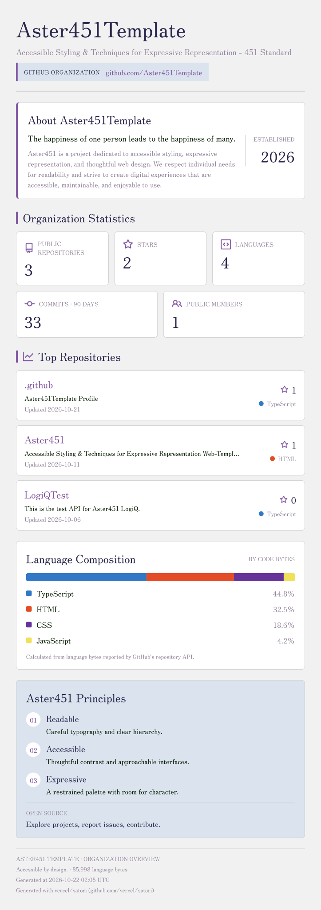
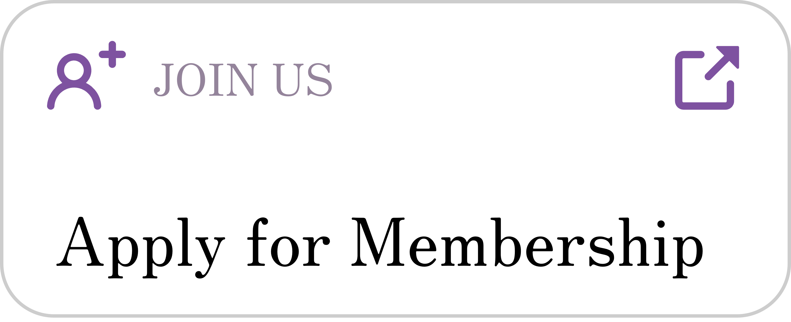
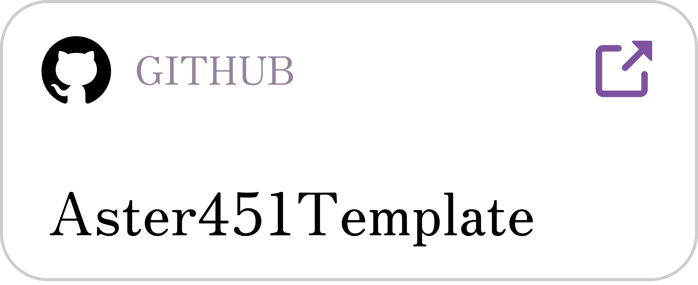
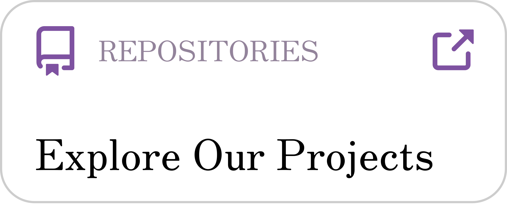
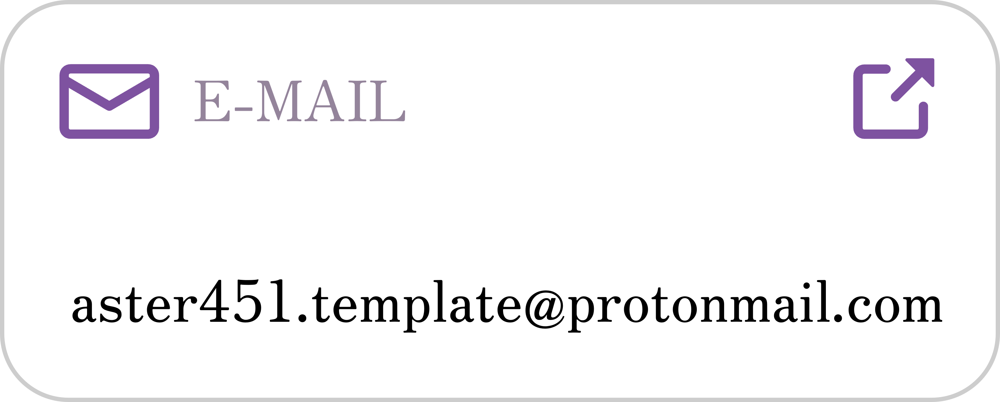

# Aster451 Template

**Accessible Styling & Techniques for Expressive Representation - 451 Standard**

Aster451Template is an organization dedicated to creating accessible, readable, and reusable web experiences through thoughtful design, typography, and development.

We aim to make the web more comfortable to read, easier to navigate, and simpler to customize. Our projects explore the intersection of design systems, frontend development, accessibility, and practical usability.

## Automatic Acquisition

The information above is automatically generated from GitHub data and may change as repositories and organizational activity evolve.

## About Aster451 Template

Aster451 Template began as a personal project by its creator, sharing the same name. It was originally conceived as a knowledge-base-style CSS/JS template designed to organize frequently used elements into a clear, intuitive, and reusable structure.

The project grew out of the creator's early struggles and frustrations with CSS and JavaScript. Rather than repeatedly solving the same problems from scratch, the idea was to bring useful components, techniques, and patterns together in one place, making everyday development more comfortable and efficient.

This approach is guided by two goals:

- **QOL (Quality of Life):** Making development workflows more comfortable and reducing unnecessary friction.
- **QOC (Quality of Coding):** Encouraging code that is clear, consistent, maintainable, and reusable.

Over time, the project evolved beyond a personal template into a broader effort to share knowledge, tools, and ideas with others.

At its core, Aster451 Template is built around **personal usability**: creating tools and resources that fit real workflows, address practical frustrations, and help people work in ways that suit their needs.

We believe that improving the tools we use can improve not only the code we write, but also the experience of writing it.

Aster451Template carries this philosophy forward through open discussion and collaboration, welcoming ideas and feedback from anyone interested in making web development more comfortable and accessible.

## Our Canon

>
> The happiness of one person leads to the happiness of many.
>

We believe that improving the usability of tools for individuals can help reduce everyday frustrations for people beyond ourselves.

Small improvements in one person's workflow may ultimately make a difference to many others.

## Our Principles

- **Readable:** Careful typography and clear hierarchy.
- **Accessible:** Thoughtful contrast and approachable interfaces.
- **Expressive:** A restrained palette with room for character.

## Projects

Our work spans several areas:

- **Design Systems & CSS:** Reusable styles, themes, and interface components.
- **Web Development:** Tools and applications that improve the experience of building and using websites.
- **Documentation:** Guides, examples, and resources that make projects easier to understand and use.
- **Experiments:** Prototypes and exploratory projects that investigate new ideas in design and technology.

Explore our public repositories to discover our projects, source code, documentation, and areas of ongoing development.

## Join Aster451Template

Interested in joining Aster451Template? Everyone is welcome to apply.

Membership is generally open. Requests receive a minimal review intended only to prevent spam, abuse, and other disruptive behavior.

  

Submit your application through GitHub Issues. An organization administrator will review it and, if approved, send you an invitation to join the organization.

You are welcome to share ideas, report bugs, and discuss improvements through public Issues without becoming a member.

## Contributing

Aster451Template welcomes ideas, suggestions, and feedback from everyone.

You do not need to be an organization member to participate in discussions or propose improvements.

- **Suggestions:** Share ideas and feature requests through Issues.
- **Bug Reports:** Report unexpected behavior and help identify problems.
- **Discussion:** Ask questions and exchange ideas through relevant Issues.

### Direct Contributions

Direct contributions to project development, including code, documentation, and design, are intended primarily for organization members.

If you would like to participate more directly in our projects, we welcome you to apply for membership.

This approach keeps the door open to ideas from everyone while helping us maintain a manageable and consistent development process.

Before opening an Issue, please check whether a similar one already exists and provide enough context for others to understand your proposal.

## Community Guidelines

We strive to maintain a respectful, constructive, and collaborative environment.

- Treat other contributors with respect.
- Keep discussions relevant and constructive.
- Avoid spam, harassment, and other disruptive behavior.
- Provide sufficient context when sharing suggestions or reporting problems.
- Respect the licenses and contribution guidelines of individual projects.

Membership is generally open, but applications may be declined and membership may be revoked in cases of abusive or disruptive behavior.

## License

Each repository may have its own license and usage conditions. Please consult the relevant repository's license before using, modifying, or redistributing its contents.

## Contact & Links

  
  

  
  

**Build together, openly.**
